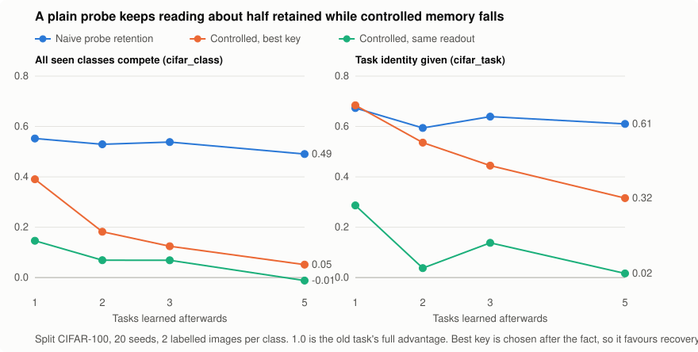

# clu

[](https://github.com/meta-lucky-builds/clu/actions/workflows/tests.yml)
[](LICENSE)

**Preregistered experiments on how neural networks forget, and on whether ideas from the biology of memory help AI.**

Six hypotheses, each committed before its data. The main question: when a network "forgets" an old task, has the
memory been overwritten, or is it still there and just hard to reach?

**Short answer.** It depends on the setting and on how much is learned afterwards, and a common way of measuring it can
mislead. No biology-to-AI mapping has been supported so far, and this repo records that plainly.

## Top findings

### 1. A plain probe can report memory that the network does not have



Fit a new linear readout for an old task and compare its accuracy with the one on the original network. That ratio stays
between about 0.5 and 0.7 however much is learned afterwards, so it looks like at least half the task survives. The catch is that
later training also raises scores on tasks the network **never saw**. After 5 later tasks with all seen classes competing, the
readout scores **0.317 on the trained task and 0.321 on never-seen tasks**, while plain retention still says 0.49.

| Split CIFAR-100, ResNet-18, 20 fresh seeds | Plain retention | Controlled for never-seen tasks | Gap, 95% CI |
| --- | --- | --- | --- |
| All seen classes compete | 0.55 | 0.15 | **0.41** [0.35, 0.47] |
| Task identity given | 0.59 | 0.04 | **0.56** [0.46, 0.67] |

The gap was positive in all 20 seeds in both settings. **Limit: this was measured at 2 labelled images per class only**, and with
task identity given the fresh readout is itself a weak key, so the gap against the strongest key at that test point is just 0.06.
[Full result](results/h6/RESULT.md).

### 2. Forgetting is not one thing

Shares of what was lost. "Unrecovered" means none of the tested keys brought it back, which makes it **an upper limit on
overwriting, not a measurement of it**.

| Setting | Learned afterwards | Loss of access | Unrecovered, at most overwriting | Verdict |
| --- | --- | --- | --- | --- |
| Small MLP, permuted MNIST, tasks compete for outputs | 1 task | 0.96 [0.92, 0.99] | 0.04 | **Mostly access** |
| Small MLP, permuted MNIST, shared outputs | 5 tasks | 0.46 [0.41, 0.51] | 0.53 | **No majority**, depends on baseline |
| ResNet-18, Split CIFAR-100, all seen classes compete | 1 task | 0.15 [0.07, 0.21] | 0.61 | **Mostly unrecovered**, at 2 images per class |
| ResNet-18, Split CIFAR-100, task identity given | 2 tasks | no valid reading | 0.80 | **Mostly unrecovered**, at 2 images per class |

On the MLP, the MNIST verdict numbers replicated on fresh seeds, and access gives way to unrecovered damage as learning continues.
The MLP and ResNet rows differ in network, data and budget all at once, so no single cause explains the difference.
[MNIST result](results/h5/RESULT.md).

### 3. The damage is in the body of the network, not the output layer

Restoring the saved feature layers brings back 0.97 to 1.00 of the old task's advantage in the CIFAR experiment, at every lag.
Restoring the output layer adds at most 0.07. On the MLP, late damage is likewise in the hidden layers. Batch norm
recalibration, a zero-label fix that was predicted to help, added 0.03 at most at the test points.

### 4. A clean negative: holding back on surprise loses to hedging

The idea was to delay learning from a surprising sample until something corroborates it. It failed its gate. A short derivation
shows why: under squared error, when a jump could be a real change or a one-off, staying put costs **about twice** what the
midpoint costs. The data match, 12.99 against 6.76. [Result](results/h1_stage_a/RESULT.md).

### 5. Method: stopping early is a result too

Three designs could not answer their questions, and the records say so rather than reporting their numbers as evidence. One had
a ceiling of about 0.2 on its own metric, found only after 165 minutes. Pilots with positive controls then stopped two more
designs, avoiding about 414 projected minutes of runs. [Lessons learned](docs/MAPPINGS.md#method-lessons-each-paid-for).

## All experiments

| | Question | Outcome | Record |
| --- | --- | --- | --- |
| H1 | Commit surprising samples only after corroboration? | **Negative**, gate failed | [plan](hypotheses/H1_corroboration_gating.md), [result](results/h1_stage_a/RESULT.md) |
| H2 | One multi-timescale state for protection and recycling? | **No conclusion**, design failure | [plan](hypotheses/H2_shared_synaptic_state.md), [result](results/h2_shared_state/RESULT.md) |
| H2R | H2, redesigned | **Stopped by pilot**, claim untested | [plan](hypotheses/H2R_shared_state_redesign.md), [result](results/h2r/RESULT.md) |
| H4 | Does schema consistency add beyond gradient overlap? | **Stopped by pilot**, claim untested | [plan](hypotheses/H4_schema_replay_dose.md), [result](results/h4/RESULT.md) |
| H5 | Overwriting or loss of access, on an MLP? | **Answered** in two of three settings | [plan](hypotheses/H5_overwrite_or_access.md), [result](results/h5/RESULT.md) |
| H6 | Do probes overstate memory, on a ResNet? | **Yes**, at 2 images per class | [plan](hypotheses/H6_cifar_probe_test.md), [result](results/h6/RESULT.md) |

H3, on self-generated gates, was designed in the [literature notes](docs/literature/gating_metacognition.md) and never run.

## How the forgetting measurement works

Accuracy on an old task mixes memory with general ability, so each measure compares the old task `A` with never-trained
tasks `C` **on the same network**:

    advantage_k(w) = accuracy_k(w, A) - accuracy_k(w, C)
    S_k(m)         = advantage_k(w_m) / advantage_k(w_0)

`k` is a key: nothing, an output mask, a new readout, a low-rate fine-tune and so on. A key that works proves storage. A key that
fails proves only that this key failed. Every setting must first pass blind checks: a sham that should read 0, random erasure that
should read 0, and a planted access failure that should read near 1. Constants are chosen on separate seeds that never score the old
task on a later network with any key but "nothing".

## What this does not show

- **Anything about brains.** These experiments test artificial networks.
- **That the biological analogies are right.** [The ledger](docs/MAPPINGS.md) lists zero supported mappings.
- **That published probe studies are wrong.** H6 used one small network at a very low label budget.
- **How much is truly overwritten.** Only an upper limit is measured, and it depends on which keys were tried.
- **Results at larger budgets on CIFAR.** That sweep was cut to save compute, and it is the main open question.

## Reproduce

Python 3.10 or later. Results in `results/` were produced on cloud machines.

```bash
pip install -e ".[test]"
python -m pytest tests -q
```

| Experiment | Command | Machine used |
| --- | --- | --- |
| H1 | `python experiments/h1_stage_a.py` | CPU, about 20 minutes |
| H2 | `python experiments/h2_shared_state.py` | CPU, about 165 minutes |
| H2R | `python experiments/h2r.py --stage0` | CPU, about 49 minutes |
| H4 | `python experiments/h4_schema.py --stage0` | CPU, a few minutes |
| H5 | `python experiments/h5_access.py calibrate`, then `confirm`, then `sensitivity` | CPU, hours |
| H6 | `pip install torch`, then `python experiments/h6_cifar.py run` | RTX 5090, 72 minutes |

H6 is one self-contained file: it downloads and verifies CIFAR-100, tests itself, and resumes if interrupted. It needs a GPU, and GPU
runs are not bit-for-bit reproducible. `experiments/h6_audit.py` and `experiments/h6_figure.py` rebuild the post hoc numbers and the
figure from the stored data, with no training. H1's per-seed files were not kept, so rerun it to regenerate them.

## Repository map

| Path | Contents |
| --- | --- |
| [`hypotheses/`](hypotheses) | Preregistrations, each with a log of deviations |
| [`experiments/`](experiments) | One runnable file per experiment |
| [`results/`](results) | Verdicts in each `RESULT.md`, with raw data and logs |
| [`tests/`](tests) | Tests for the experiment code and the verdict rules |
| [`src/clu/`](src/clu) | Learners and streams for H1 |
| [`docs/MAPPINGS.md`](docs/MAPPINGS.md) | Ledger of every biological idea tested, and method lessons |
| [`docs/CHARTER.md`](docs/CHARTER.md) | The rules: what counts as a valid mapping and a valid experiment |
| [`docs/STATUS.md`](docs/STATUS.md) | Where the work stands and what comes next |
| [`docs/literature/`](docs/literature) | Evidence notes, with how deeply each source was read |

Git history is part of the evidence: each preregistration was committed before its results, and later changes are logged as
deviations. The full step-by-step history is on `main`.

## License

[MIT](LICENSE)
